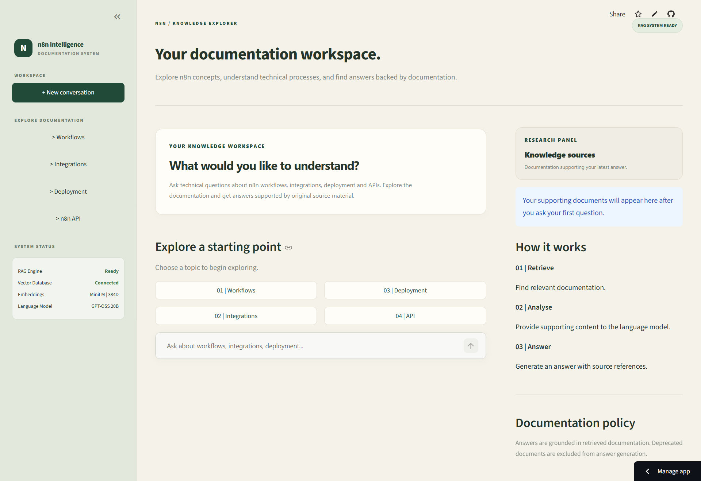
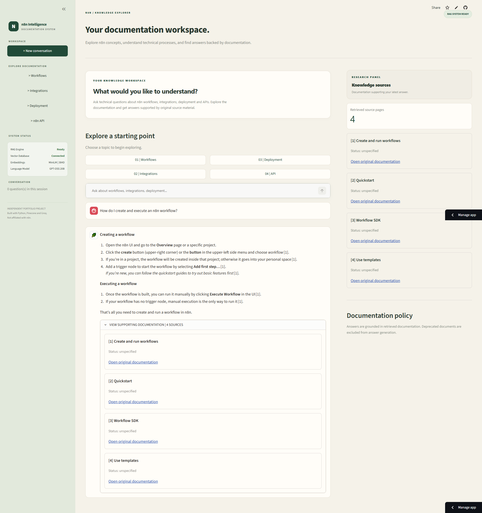
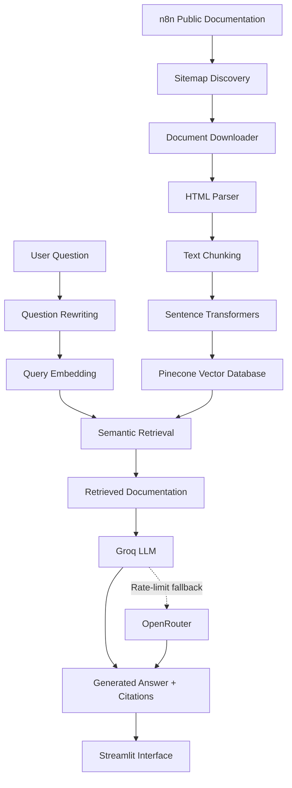

# N8N Documentation Intelligence
### An AI-Powered Retrieval-Augmented Generation (RAG) Assistant

[](https://n8n-documentation-intelligence.streamlit.app/)
[](https://www.python.org/)
[](https://www.pinecone.io/)
[](https://groq.com/)

**[Try the Live Application](https://n8n-documentation-intelligence.streamlit.app/)** | **[View Source Code](https://github.com/Olami2596/n8n-documentation-rag)**

---

## Overview

N8N Documentation Intelligence is an AI-powered documentation assistant that uses Retrieval-Augmented Generation (RAG) to answer technical questions about [n8n](https://n8n.io/).

The system retrieves relevant information from n8n's public documentation, supplies the retrieved content to a language model, and generates contextual answers with references to the original documentation.

Rather than relying entirely on an LLM's pre-trained knowledge, the application grounds its responses in retrieved documentation.

The project demonstrates an end-to-end RAG engineering workflow, covering documentation discovery, web scraping, content processing, chunking, embedding generation, vector database indexing, semantic retrieval, conversational question rewriting, LLM orchestration, and deployment.

**This is an independent portfolio project and is not affiliated with or endorsed by n8n.**

## Live Demo

**[Launch N8N Documentation Intelligence](https://n8n-documentation-intelligence.streamlit.app/)**

The application provides:

- Natural-language questions about n8n.
- Semantic retrieval from the n8n documentation corpus.
- Context-aware follow-up questions.
- Answers grounded in retrieved documentation.
- Source references and links to original documentation.
- Automatic LLM fallback when the primary provider encounters rate limits.
- Deprecated documentation detection and exclusion from answer generation.

## Application Screenshots

### Main Interface

The documentation workspace provides topic navigation,
system status, and a conversational interface.



### Answer Generation and Source Retrieval

The application generates documentation-grounded answers
and displays the supporting documentation sources.



## Architecture

The application follows a retrieval-augmented generation architecture.



### How it works

1. **Documentation discovery:** The ingestion pipeline discovers documentation URLs through n8n's public sitemaps.
2. **Document extraction:** Documentation pages are downloaded and their relevant content is extracted from HTML.
3. **Text processing:** Extracted content is divided into overlapping chunks while preserving useful structural information.
4. **Embedding generation:** Sentence Transformers converts each chunk into a numerical vector.
5. **Vector storage:** Embeddings and associated metadata are stored in Pinecone.
6. **Question processing:** User questions are rewritten into standalone queries when conversational context is available.
7. **Semantic retrieval:** The question is embedded and used to retrieve relevant documentation chunks from Pinecone.
8. **Answer generation:** Retrieved documentation is supplied to the language model, which generates a grounded response.
9. **Source attribution:** The application presents references to the original documentation pages.

## Dataset and Ingestion

The project uses publicly accessible n8n documentation.

### Corpus statistics

| Metric | Result |
|---|---:|
| Documentation pages discovered | 1,422 |
| Documentation pages downloaded | 1,422 |
| Failed downloads | 0 |
| Processed documentation pages | 1,422 |
| Generated text chunks | 12,287 |
| Embedding dimensions | 384 |
| Invalid embedding vectors | 0 |

The ingestion pipeline covers documentation categories including:

- Workflows and building blocks
- Deployment
- Integrations
- Administration
- Connections
- Privacy and security
- Community and contribution documentation
- Changelog and release information

### Chunking strategy

The project uses LangChain's `RecursiveCharacterTextSplitter`.

| Parameter | Configuration |
|---|---:|
| Chunk size | 800 characters |
| Chunk overlap | 120 characters |
| Embedding model | all-MiniLM-L6-v2 |
| Embedding dimensions | 384 |
| Normalization | Enabled |

A table-aware splitting strategy is also used to preserve Markdown table headers and row relationships where possible.

### Embedding model

The project uses:

`sentence-transformers/all-MiniLM-L6-v2`

The model runs locally and generates normalized 384-dimensional embeddings.

### Vector database

Pinecone stores the document vectors and their associated metadata.

| Configuration | Value |
|---|---|
| Index | `n8n-documentation` |
| Namespace | `n8n-full-corpus` |
| Dimension | 384 |
| Similarity metric | Cosine |
| Retrieval strategy | Dense semantic retrieval |
| Default top-k | 5 |

Metadata includes document titles, URLs, categories, document identifiers, status information, and chunk content.

## Technology Stack

| Component | Technology |
|---|---|
| Programming language | Python |
| Frontend | Streamlit |
| Web scraping | Requests, BeautifulSoup |
| Text processing | LangChain Text Splitters |
| Embedding model | Sentence Transformers |
| Vector database | Pinecone |
| Primary LLM provider | Groq |
| Primary language model | GPT-OSS 20B |
| Fallback provider | OpenRouter |
| Fallback model | NVIDIA Nemotron 3 Ultra 550B A55B |
| API clients | Groq SDK, OpenAI SDK |
| Environment configuration | python-dotenv |
| Version control | Git and GitHub |
| Deployment | Streamlit Community Cloud |

## LLM Orchestration and Automatic Fallback

The application uses a primary-and-fallback model strategy.

**Primary provider: Groq**

- Model: `openai/gpt-oss-20b`
- Handles question rewriting and answer generation.

**Fallback provider: OpenRouter**

- Model: `nvidia/nemotron-3-ultra-550b-a55b:free`
- Automatically receives requests when the primary Groq provider returns a rate-limit error.

The fallback mechanism helps maintain application availability when the primary provider reaches its rate limits.

The application also includes error handling and logging to make failures easier to investigate without exposing technical details to end users.

## Retrieval Evaluation

Retrieval quality was evaluated using a dedicated question dataset and multiple retrieval metrics.

The final production configuration uses dense-only semantic retrieval.

### Selected production configuration

| Metric | Chunk-level | Document-level |
|---|---:|---:|
| Precision@5 | 0.3533 | 0.3200 |
| Mean Reciprocal Rank (MRR) | 0.7139 | 0.7222 |
| Normalized Discounted Cumulative Gain (NDCG) | 0.8592 | 0.8697 |
| Hit Rate | 0.9333 | 0.9333 |

### Metrics explained

- **Precision@5:** Measures the proportion of the top five retrieved results that are relevant.
- **MRR:** Measures how highly the first relevant result appears in the ranking.
- **NDCG:** Evaluates the quality of the ranking while considering the positions of relevant results.
- **Hit Rate:** Measures how frequently at least one relevant result appears in the retrieved results.

### Retrieval strategy decision

Dense-only retrieval was selected for production after comparing it with a hybrid retrieval experiment.

The dense-only configuration produced stronger MRR and NDCG results in the final corrected evaluation, making it the preferred ranking strategy for this implementation.

Hybrid retrieval was retained as an experiment rather than adopted as the production configuration.

## Project Structure

```text
n8n-documentation-rag/
│
├── config/
│
├── data/
│   ├── raw/
│   ├── processed/
│   └── metadata/
│
├── ingestion/
│   ├── scraper.py
│   ├── downloader.py
│   ├── full_downloader.py
│   ├── parser.py
│   ├── chunker.py
│   ├── embedder.py
│   ├── chunk_full_corpus.py
│   ├── embed_full_corpus.py
│   └── uploader.py
│
├── vectorstore/
│   ├── embeddings.py
│   └── pinecone_store.py
│
├── rag/
│   ├── generator.py
│   └── retriever.py
│
├── scripts/
│
├── tests/
│
├── app.py
├── main.py
├── requirements.txt
├── requirements-lock.txt
├── .gitignore
└── README.md
```

**Note:** Downloaded documentation, generated datasets, embeddings, and local environment files are excluded from the GitHub repository. The deployed application connects to the existing Pinecone index.

## Running Locally

### 1. Clone the repository

```bash
git clone https://github.com/Olami2596/n8n-documentation-rag.git

cd n8n-documentation-rag
```

### 2. Create a virtual environment

```bash
python -m venv .venv
```

Activate it on Windows:

```powershell
.venv\Scripts\Activate.ps1
```

### 3. Install dependencies

```bash
pip install -r requirements.txt
```

### 4. Configure environment variables

Create a `.env` file in the project root:

```env
PINECONE_API_KEY=your_pinecone_api_key
GROQ_API_KEY=your_groq_api_key
OPENROUTER_API_KEY=your_openrouter_api_key
```

Never commit your `.env` file or expose API credentials publicly.

### 5. Run the application

```bash
streamlit run app.py
```

The application will start locally and connect to the configured Pinecone index.

The embedding model is downloaded and loaded when the application initializes for the first time.

**Deployment note:** The deployed application uses Streamlit Community Cloud Secrets for credential configuration.

## Deployment

The application is deployed using Streamlit Community Cloud.

Deployment configuration:

| Setting | Value |
|---|---|
| Repository | `Olami2596/n8n-documentation-rag` |
| Branch | `main` |
| Entry point | `app.py` |
| Runtime | Python 3.14 |
| Vector database | Pinecone |
| Secrets | Streamlit Secrets |

**[Open the live application](https://n8n-documentation-intelligence.streamlit.app/)**

## Engineering Decisions

Some of the important engineering decisions made during development include:

1. **Local embedding generation:** Sentence Transformers was selected to generate embeddings without depending on a hosted embedding API.
2. **Persistent vector storage:** Pinecone provides a managed vector database that allows the application to retrieve documents without rebuilding the index on every startup.
3. **Overlapping chunks:** Chunk overlap helps preserve context across document boundaries.
4. **Conversational query rewriting:** Follow-up questions are rewritten into standalone queries to improve retrieval.
5. **Source attribution:** Answers include references to original documentation pages to improve traceability.
6. **Deprecated content handling:** Deprecated documents are identified and excluded from answer generation.
7. **LLM fallback:** OpenRouter provides an alternative generation provider when Groq encounters rate limits.
8. **Dense-only production retrieval:** Dense retrieval was selected based on the final evaluation results rather than adopting hybrid retrieval without sufficient justification.

## Limitations and Future Improvements

Potential areas for further development include:

- Improved retrieval precision and ranking.
- More extensive answer-quality and faithfulness evaluation.
- Stronger handling of conflicting or outdated documentation.
- Additional query-intent classification.
- Improved source-level relevance validation.
- Expanded monitoring and observability.
- More comprehensive automated integration tests.

## Acknowledgements

- [n8n](https://n8n.io/) for its publicly accessible documentation.
- [Sentence Transformers](https://www.sbert.net/) for the embedding model.
- [Pinecone](https://www.pinecone.io/) for vector storage and retrieval.
- [Groq](https://groq.com/) and [OpenRouter](https://openrouter.ai/) for language model inference.
- [Streamlit](https://streamlit.io/) for application development and hosting.

---

**Built as an independent AI engineering portfolio project.**

[Live Application](https://n8n-documentation-intelligence.streamlit.app/) · [GitHub Repository](https://github.com/Olami2596/n8n-documentation-rag)
